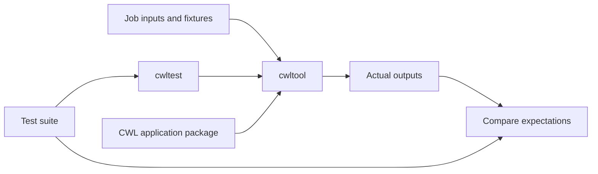

# Testing Earth Observation Application Packages

This repository provides a working example of testing an Earth Observation Application Package (EOAP) with Common Workflow Language (CWL). It combines a declarative test suite, satellite data fixtures, and expected outputs for a water-body detection application.

The processing application is supplied by the external `app-water-bodies-cloud-native` release, version `1.1.0`. This repository contains its testing baseline rather than the processing implementation.

## Start here

- [Getting started](getting-started.md): prepare your environment and run a first test.
- [Water-bodies example](water-bodies.md): follow the processing stages and understand the six existing cases.
- [Writing tests](writing-tests.md): define inputs and assertions for your own application.
- [Fixtures and reproducibility](reproducibility.md): maintain datasets and review deterministic outputs.
- [Continuous integration](continuous-integration.md): understand automation and preview this documentation.
- [Troubleshooting](troubleshooting.md): diagnose execution and comparison failures.

## How the pieces fit together

`cwltest` reads the YAML test definitions and invokes a CWL runner, here `cwltool`. The runner executes the selected tool or workflow using its job inputs. The test framework then compares the returned outputs with the expectations in the suite. See the [upstream cwltest project](https://github.com/common-workflow-language/cwltest) for the framework's command-line entry points.



## What passing tests establish

The suite exercises individual processing steps and their connection in a complete workflow. Fixed checksums provide evidence that selected artifacts match the baseline byte for byte. Flexible file assertions provide narrower evidence: a step returned the expected kind of output.

Passing this suite alone does not establish scientific accuracy, STAC schema compliance, performance, or successful deployment through an OGC API Processes service. Add dedicated checks for those properties when they are part of your application's requirements. Likewise, portability to another runner needs execution and validation on that runner.

## Repository map

```text
tests/
  test-suite.yaml      # Cases and expected outputs
  inputs-01.yaml      # Green-band crop
  inputs-02.yaml      # Near-infrared crop
  inputs-03.yaml      # Normalized difference
  inputs-04.yaml      # Thresholding
  inputs-05.yaml      # Catalog generation
  inputs-e2e.yaml     # Full workflow
  data/               # Source and intermediate fixtures
docs/                 # This guide
mkdocs.yml            # Website configuration
.github/workflows/    # Tests and documentation automation
```
