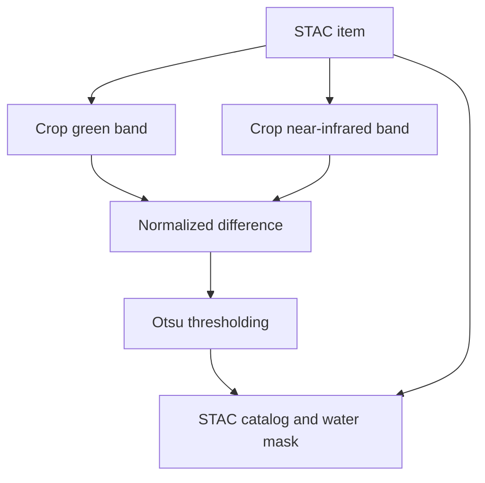

# Water-bodies example

The test suite selects tools and the workflow from this release document:

```text
https://github.com/eoap/mastering-app-package/releases/download/1.1.0/app-water-bodies-cloud-native.1.1.0.cwl
```

A fragment such as `#crop` selects a process in that CWL document. The end-to-end case selects `#water-bodies`.

## Processing stages



The crop jobs use the bounding box `-121.409,39.824,-120.73,40.482` and the coordinate reference system `EPSG:4326`. Their `band` parameter selects `green` or `nir`. The item fixture identifies a Sentinel-2B scene acquired on 13 July 2021 and provides asset links for those inputs.

Normalized difference combines the two cropped rasters into NDWI. Otsu thresholding converts that intermediate raster into a binary mask. The final step associates the mask with item metadata and writes a STAC catalog.

## Existing cases

| ID | CWL fragment | Job | Output assertion |
| --- | --- | --- | --- |
| `crop-green` | `#crop` | `inputs-01.yaml` | `cropped`: File, flexible location |
| `crop-nir` | `#crop` | `inputs-02.yaml` | `cropped`: File, flexible location |
| `normalized-difference` | `#norm_diff` | `inputs-03.yaml` | `ndwi`: File, flexible location |
| `otsu-threshold` | `#otsu` | `inputs-04.yaml` | `binary_mask_item`: File, flexible location |
| `stac-generation` | `#stac` | `inputs-05.yaml` | `stac_catalog`: Directory with sizes and checksums |
| `workflow-end-to-end` | `#water-bodies` | `inputs-e2e.yaml` | The same deterministic catalog expectation |

The five unit cases execute application steps through the CWL runner. They can still require containers and network access. The normalized-difference, thresholding, and catalog cases use saved intermediate rasters, allowing each step to be investigated independently of upstream execution.

## End-to-end inputs

The full workflow uses this job structure:

```yaml
stac_items:
  - https://github.com/eoap/testing-framework/raw/refs/heads/main/tests/data/item.json
aoi: "-121.409,39.824,-120.73,40.482"
epsg: "EPSG:4326"
bands:
  - green
  - nir
```

## Expected catalog

Both catalog tests check three files, including the water-mask raster:

```text
catalog.json
S2B_10TFK_20210713_0_L2A/
  S2B_10TFK_20210713_0_L2A.json
  otsu.tif
```

The expected sizes in the suite are 363 bytes for the catalog, 2,755 bytes for the item, and 6,918 bytes for the mask. The suite also records a SHA-1 checksum for each file.

These comparisons detect changes to the baseline artifacts. They do not independently validate the STAC schemas or judge whether the detected water bodies are scientifically correct. See [writing tests](writing-tests.md) for choosing assertions and [reproducibility](reproducibility.md) for maintaining the baseline.
